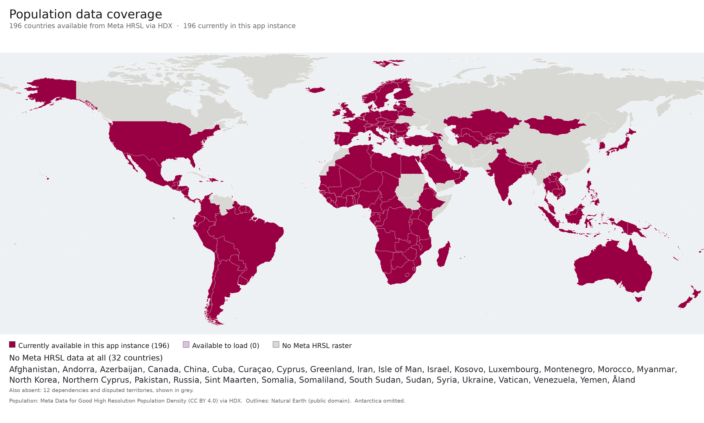

# Tally

Draw a shape on a map and see how many people live inside it, with a density heatmap.

**Try it: https://tallymaps.org**

- **Shape:** draw any polygon. **Radius:** everyone within a distance of a point.
  **Country:** a whole country at once.
- 198 countries and territories, from 30 m population estimates (100 m for Canada,
  Greenland and Jersey).
- Runs entirely in your browser. Country data downloads on first use and stays available
  offline. Nothing you draw leaves your device.
- Works on phones and installs as an app (PWA).



This repository lets you build and run Tally on your own computer, for the countries you
choose. Everything below is plain commands; no account, API key or AI tool is needed.

## How it works

All the expensive work happens once, when the data is prepared. Each country's population
raster is clipped to its border, binned into [H3][h3] hexagons at about 0.1 km², and rolled
up into coarser levels. The result is a set of small per-country **packs**. To answer a
question, the browser covers your shape with hexagons at a resolution that suits its size,
downloads only the parts of the packs it needs, and adds up the hexagons. A city block and
a continent both come back in a few thousand hexagons.

Hexagons are counted when their **centre** is inside the shape, so shapes placed next to
each other never count anyone twice and never leave a gap.

The details and the design decisions are in [docs/ARCHITECTURE.md](docs/ARCHITECTURE.md).

## Quick start

You need a Mac or Linux computer (on Windows, use [WSL][wsl]) with an internet
connection, and three tools:

| Tool | Check | Install |
| --- | --- | --- |
| git | `git --version` | macOS: `xcode-select --install`; Ubuntu/Debian: `sudo apt install git` |
| make | `make --version` | Comes with git above (macOS); Ubuntu/Debian: `sudo apt install make` |
| [uv][uv] | `uv --version` | `curl -LsSf https://astral.sh/uv/install.sh \| sh`, then open a new terminal |

uv installs the right Python (3.12) and every library by itself; you do not need Python
installed beforehand. Python 3 is also used to serve the pages (`python3 -m http.server`);
macOS and most Linux systems already have it.

Then:

```bash
git clone https://github.com/wmclendon2/tally-maps.git
cd tally-maps
make setup    # installs Python 3.12 and the libraries into .venv/ (a few minutes, once)
make demo     # builds Cameroon and the Central African Republic, then serves the app
```

Open **http://127.0.0.1:8081** in your browser. Press Ctrl-C in the terminal to stop.

`make demo` downloads about 220 MB the first time (two population rasters of 24 and 32 MB,
their country outlines and their neighbours', geoBoundaries' 162 MB world map that splits
outlines where neighbours overlap, and Natural Earth's world map for the grey "no data"
areas) and
takes a minute or two. Later runs reuse everything already downloaded or built.

### Other countries

Pass ISO3 codes (`KEN` Kenya, `BRA` Brazil, `IND` India, ...):

```bash
make demo COUNTRIES="KEN TZA UGA"
```

The app shows exactly the countries in that build. `docs/img/coverage.json` lists every
country with data (`available`). `make catalog` lists Meta's catalogue with each
country's download size. A few countries have no Meta data at all
(Russia, China, Pakistan and others; see the map above) and cannot be built yet; Canada
and Greenland are built from WorldPop instead.

Each country is built in parallel with the others; large ones take a few minutes (Brazil
about 2.5) and need up to ~4 GB of memory each. Most downloads are under 200 MB; the
largest are India (780 MB) and the USA (1.1 GB). All of Meta's countries come to 6.4 GB.

### All the commands

`make help` lists them. Each one is a short command you can also run directly:

| make | Runs | What it does |
| --- | --- | --- |
| `make setup` | `uv sync` | Installs Python and the libraries into `.venv/` |
| `make catalog` | `uv run python -m ingest.hdx` | Lists every country with data, and its download size |
| `make packs` | `uv run python scripts/build_packs.py --country CMR ...` | Downloads and builds data packs into `data/packs/` |
| `make site` | `uv run python scripts/build_static.py --country CMR ...` | Builds the app into `dist/` (and any missing packs) |
| `make serve` | `python3 -m http.server 8081 --directory dist --bind 127.0.0.1` | Serves `dist/` locally |
| `make demo` | `make site` then `make serve` | |
| `make test` | `uv run pytest -q` | Runs the tests (no downloads needed) |
| `make check` | ruff, then the tests | Style and tests (GitHub runs the same on every push) |

`COUNTRIES="..."` picks the countries for `packs`, `site`, `demo` and `verify`, and
`PORT=8090` changes the port for `serve` and `demo`.

### Where things go

| Path | What | Safe to delete? |
| --- | --- | --- |
| `data/raw/` | Downloaded population rasters | Yes; downloaded again when needed |
| `data/boundaries/`, `data/natural_earth/`, `data/cgaz/` | Downloaded country outlines, and the clips made from them | Yes; downloaded or made again |
| `data/packs/` | Built packs and `catalog.json` | Yes; rebuilt from the rasters |
| `dist/` | The built app | Yes; `make site` rewrites it |
| `.venv/` | Python and libraries | Yes; `make setup` recreates it |

None of these are tracked by git.

### Troubleshooting

- **"Address already in use"**: another program uses port 8081. Use `make demo PORT=8090`
  and open http://127.0.0.1:8090.
- **The page does not change after a rebuild.** The app caches itself to work offline.
  Reload the page; if it says "Tally has been updated", press Reload. Make sure
  the server is still running: with it stopped, the cached app keeps opening from memory.
- **A download fails** (a network error or a timeout). Run the same command again; finished
  countries are kept, and downloads are retried.
- **`uv: command not found`** right after installing uv: open a new terminal window.

## Using the app

- **Shape:** press **Draw a shape**, click the map to place corners, then click the first
  corner again. On a touch screen, move the map under the crosshair, tap **Add corner** for
  each corner, then **Finish**.
- **Radius:** set the distance, press **Pick a point** and click the map.
- **Country:** pick a country for its whole population, area and density.
- **Normal / Fine:** Normal answers with a few thousand hexagons; Fine uses hexagons one
  level smaller, which follow the shape's edge more closely.
- Point at (or tap) a hexagon for its own estimate. The hexagon **?** button opens About
  Tally: the data and its limits, units, and the countries saved for offline use.

The figures are **modelled estimates, not census counts**, and are least reliable near
coasts, borders and in places that have changed recently.

## Data

| Source | Used for | Licence |
| --- | --- | --- |
| [Meta High Resolution Population Density Maps][hrsl] via [HDX][hdx] | Population, 30 m | CC BY 4.0 |
| [WorldPop](https://www.worldpop.org) | Population, 100 m, where Meta has no data (Canada, Greenland, Jersey) | CC BY 4.0 |
| [geoBoundaries][gb] | Country outlines for clipping; its CGAZ set splits outlines that overlap | CC BY 4.0; each outline's source keeps its own open licence (often OpenStreetMap's ODbL), listed in geoBoundaries' metadata |
| [Natural Earth](https://www.naturalearthdata.com) | City points, continents, the no-data mask, six territories' outlines | Public domain |
| [OpenFreeMap](https://openfreemap.org) / OpenStreetMap | Basemap | ODbL |

All are downloaded from their publishers when you build; none needs an account or key.

## Checking the data

```bash
make verify COUNTRIES="CMR"     # the country's total from its outline, reconciled exactly;
                                # and people in the right places, against city locations
make browser-setup              # once: the headless Chromium the browser checks use
make site && make parity        # the browser's answers equal the Python resolver's
make countries-check            # every country in dist/, and the page's memory use
make update-check               # a tab left open survives a release (new version, new data)
make overlaps                   # people counted in two countries where outlines overlap
```

Neighbouring countries' outlines overlap where their sources disagree about the border.
`reference/overlap_split.json` gives each overlap to one side, so no one is counted twice.
The split follows geoBoundaries' CGAZ world map (downloaded once into `data/cgaz/`).
After adding a country Tally has never had, with every country built, run
`make split COUNTRIES="XXX"`, then rebuild the countries it names and run `make overlaps`.

How the checks work, and the results so far: [docs/VERIFICATION.md](docs/VERIFICATION.md).

## Layout

| Path | What it is |
| --- | --- |
| `ingest/` | Download from HDX, clip, bin to H3, roll up; the Python reference resolver |
| `scripts/` | Packs, the static build, verification, the coverage map |
| `web/` | The app: MapLibre, Terra Draw, h3-js. No build step |
| `reference/` | Small checked-in data: city locations, continents, how overlapping outlines are split |
| `tests/` | `pytest` suite |
| `docs/` | Architecture, verification, data sources, roadmap |

## Roadmap

Planned and shipped features: [docs/ROADMAP.md](docs/ROADMAP.md).

## Licence

The code is released under the [MIT License](LICENSE). The licence covers the code only.
The population data, boundaries and basemap keep their own licences (mostly CC BY 4.0,
which requires attribution). See [NOTICE.md](NOTICE.md) for credit lines and the
no-warranty note on the estimates.

[h3]: https://h3geo.org
[uv]: https://docs.astral.sh/uv/
[wsl]: https://learn.microsoft.com/windows/wsl/install
[hrsl]: https://dataforgood.facebook.com/dfg/tools/high-resolution-population-density-maps
[hdx]: https://data.humdata.org/organization/meta
[gb]: https://www.geoboundaries.org
